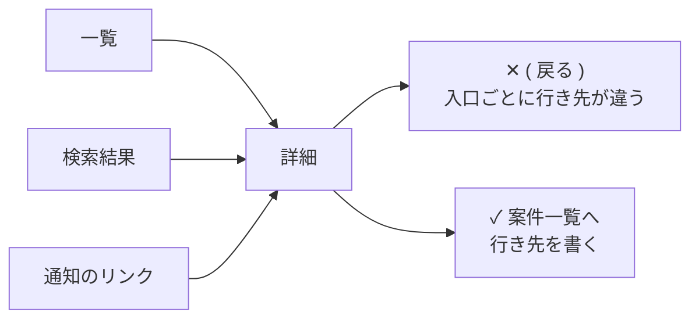

# 画面: 配置・強調・操作の置き場所を決める

AI が作った画面に感覚で修正を指示する代わりに、設計の判断基準を渡すためのメモ。

採用するのは、**複数のもっともらしい設計から選ぶときに、判断を変えられる原則**。「分かりやすくする」「使いやすくする」だけで終わる心得や、基本的な実装チェックの網羅は目的にしない。

`> ZERO:` の段は、その原則が実際に効いた例。ZERO は、この原則で作っている、AI を組み込んだ動画づくりのアプリ（中の AI も ZERO と呼ぶ）。

## 図の読み方

各原則に、文字だけの小さな図を添える。`✕` が避けたい形、`✓` がこうする形。

| 書き方 | 意味 |
|---|---|
| `[ 保存 ]` | 主ボタン（いちばん強い） |
| `( 保存 )` | 副ボタン（弱い） |
| `[______]` | 入力欄 |
| `● 10分` / `○ 30分` | 選んである / 選んでいない |
| `☑` / `☐` | チェックボックス（保存などで効く） |
| `━●` / `●━` | スイッチのオン / オフ（切り替えた瞬間に効く） |
| `…` | その行のメニュー |
| `〔写真〕` | 画像が入る場所 |
| `←` | 図への注記 |

## アジェンダ

| 設計領域 | 判断したいこと |
|---|---|
| A. 作業と負担 | 手順の少なさと、考える負担の少なさをどう両立するか |
| B. 情報の構造 | 何を強調し、何をまとめ、何を隠すか |
| C. 操作の配置 | 操作対象と影響範囲を、位置でどう伝えるか |
| D. 誤操作と制御 | どこで操作を止め、どこは取り消しで対応するか。操作の意味を状態で変えないか |
| E. 一貫性と安定性 | 何をそろえ、何を変えずに保つか。それを画面ごとではなく一か所で決めるか |

## A. 作業と負担

### 1. 操作回数が少なくても、考える負担は大きくなり得る

自由入力 1 回で済む画面でも、ユーザーが条件を思い出し、整理し、文章にしなければならないなら負担は大きい。選択を数回に分ける方が、判断しやすいことがある。

```text
✕ どんな動画にしたいですか？
  [ 対象・長さ・雰囲気を書いてください                ]  [ 送信 ]
                       ← 1 回で済むが、何を書くかを全部考えさせる

✓ 長さ    ○ ショート  ● 10分  ○ 30分
  雰囲気  ● まじめ    ○ くだけた
  対象    ● 初心者    ○ 経験者        ( 補足を書く )  [ 頼む ]
                       ← 初期値から、違う所だけ選ぶ。書きたい人の入口は残す
```

減らす対象を区別する。

| 負担 | 設計の方向 |
|---|---|
| 入力する内容を考える | 典型的な候補や初期値を用意し、違う部分だけ指定できるようにする |
| 違いを理解して選ぶ | 同じ比較軸・同じ順序で候補を並べる |
| 同じ操作を繰り返す | 前回値、一括操作、ショートカットで省略する |

**判断基準:** 手順を増やしてよいのは、それによって言語化・探索・比較の負担が減るとき。単に一問一画面に分けたり、同じ内容を何度も確認させたりするのは負担の追加になる。

### 2. 画面の区切りと、ユーザーの作業の区切りを一致させる必要はない

システムが機能別に画面を分けていても、ユーザーにとっては一連の作業であることがある。画面ごとに状態を初期化すると、移動のたびに作業を組み立て直す必要が生じる。

引き継ぐべきものは、入力内容だけではない。操作対象、選択条件、進捗、表示位置も作業の文脈に含まれる。

- 一覧から詳細を開いて戻ったら、絞り込みと表示位置を保つ。
- 前の工程で確定した情報を、次の工程で再選択・再入力させない。
- 別の対象へ切り替えるときは、逆に前の対象の選択状態を不用意に持ち越さない。

```text
✕ 一覧（未対応だけ・30 件目）→ 詳細 → 一覧（すべて・先頭）   ← 条件も位置も消える
✓ 一覧（未対応だけ・30 件目）→ 詳細 → 一覧（未対応だけ・30 件目）
```

画面の中に「戻る」ボタンを作らない。同じ詳細画面にも、一覧から来る人、検索から来る人、通知のリンクから来る人がいて、「戻る」の行き先は人によって違う。来た道を戻るのはブラウザや OS の戻るに任せる。画面の中に移動のリンクが要るなら、「案件一覧へ」のように行き先を書く。今は入口が 1 つでも、入口はあとから増える。



**判断基準:** 同じ作業の継続なら文脈を保ち、作業対象が変わるなら境界を示す。「全部を同じ画面に置く」「状態を何でも保存する」というルールにはしない。画面の中の移動は、来た道ではなく行き先で書く。

## B. 情報の構造

### 3. 強調は、単体の装飾ではなく周囲との相対関係で決まる

各ボタンを単体で見て「重要だから色を付ける」と判断すると、画面全体で強調が競合する。目立たせたい要素をさらに強くする前に、周囲の不要な強調を下げる。

同じ判断の場では、次に進む主操作を最も強くし、修正・戻る・コピーなどは役割に応じて弱める。強調に使う色・太さ・大きさを、すべての要素へ均等に配らない。

**判断基準:** 「主ボタンは 1 画面に 1 つ」を機械的に数えるのではなく、同時に注意を奪い合う操作がないかを見る。独立した作業領域やダイアログには、それぞれ主操作があり得る。閲覧だけの画面に、数合わせで主ボタンを作らない。

特に一覧では、各カードに強いボタンを置くと、項目の比較よりボタン群が目立つ。一覧の目的が比較・選択なら、まず対象を主役にする。

```text
✕ A社の撮影  [ 編集 ] [ 複製 ] [ 削除 ]
  B社の取材  [ 編集 ] [ 複製 ] [ 削除 ]
  C社の撮影  [ 編集 ] [ 複製 ] [ 削除 ]     ← ボタンの列が主役になり、比べられない

✓ 案件 3 件                       [ 案件を追加 ]
  A社の撮影  11/12  撮影待ち    …
  B社の取材  11/15  台本確認    …
  C社の撮影  11/20  企画中      …           ← 比べる値が主役。行の操作は … に
```

### 4. 余白は、広さより「内側と外側の差」で関係を伝える

すべてを同じ間隔で並べると、項目同士の関係が平坦になる。余白を一律に増やしても、どれとどれが一組なのかは伝わらない。

基本は、**グループ内の距離を、グループ間の距離より小さくする**。たとえばラベルと入力欄の距離より、隣の入力項目との距離を広くする。

```text
✕ [______________]
                     ← 「お名前」は上と下、どちらの欄の名前か分からない
  お名前

  [______________]

✓ お届け先
  お名前
  [______________]   ← ラベルは自分の欄のすぐ上
  電話番号
  [______________]
                     ← 塊と塊の間を、塊の中より広く空ける
  お支払い
  カード番号
  [______________]
```

同じ内容を枠線・背景色・影・カードの入れ子で何重にも囲むと、内容より境界が目立つ。まず近接と整列で関係を作り、それだけでは伝わらない境界に視覚的な区切りを足す。

**判断基準:** 「余白を増やす」「カードにする」ではなく、どの要素を同じまとまりとして読ませたいかを決める。一覧の全項目を独立カードにすることで比較しづらくなるなら、行や表でそろえる方がよい。

### 5. 情報を隠すと、画面は簡潔でも判断は難しくなり得る

折りたたみや別画面への分割は、表示量を減らす一方で、発見・移動・記憶の負担を増やす。情報量の少なさを、そのまま使いやすさとみなさない。

| 情報の役割 | 扱い |
|---|---|
| 候補を比較するための違い | 同時に見せ、同じ項目・順序でそろえる |
| 操作の影響や不可逆性 | 操作を判断する場所で見せる |
| 必要な人だけが読む根拠・補足 | 展開できる形にする |
| 利用頻度の低い高度な設定 | 標準操作から分離し、入口は残す |

**判断基準:** 隠してよいのは、今の判断に不要な情報。隠したことで画面を往復したり、前の内容を覚えて比較したりするなら、同時に見せる方がよい。

選択肢を「必ず 3 個」のように固定しない。数を削るより、比較軸をそろえる、分類する、適切な初期値を置くことで判断しやすくなる場合がある。

操作も同じ。押すまで・ホバーするまで出ない操作は、気づかれない。その場で決める操作（採用する・元に戻す）は、最初から見える所に置く。

```text
✕ 見出し 2 の直し  「早く撮る」→「1日で撮る」
                     ← 採用する・元のまま は、ホバーするまで出ない

✓ 見出し 2 の直し  「早く撮る」→「1日で撮る」   [ 採用する ] ( 元のまま )
```

> ZERO: 添削の画面で、直しを採用するか元のままにするかのボタンがホバーで出る形だったので気づかれなかった。見出しの行に最初から出す形に直した（2026-10-31）。

## C. 操作の配置

### 6. 操作の置き場所は、何に効く操作かという宣言になる

近くに置かれた操作は、その対象に効くものとして読まれる。実装上同じ種類のボタンだからといって、影響範囲の違う操作を一列に集めない。

| 影響範囲 | 配置の基本 |
|---|---|
| アプリ全体 | 共通ナビゲーションや共通ヘッダー |
| 一覧全体 | 一覧の見出し付近 |
| 選択した複数項目 | 選択範囲・件数との関係が見える位置 |
| 個別項目 | その行・カード・詳細内 |
| 文書の一部分 | 選択箇所や該当セクションの近く |

例えば「新規作成」は一覧に項目を増やす操作で、「削除」は特定の項目に対する操作。同じ場所に並べる前に、その操作範囲が一致しているかを確認する。

```text
✕ [ 新規作成 ] [ 削除 ] [ 複製 ] [ 書き出し ]    ← 削除と複製は、どれに効く？
  ☐ A社の撮影
  ☐ B社の取材

✓ 案件 12 件            [ 案件を追加 ] ( 書き出し )   ← 一覧全体
  2 件を選択中  ( まとめて削除 )                     ← 選んだ項目
  ☑ A社の撮影                            …          ← この行（複製・削除）
  ☑ B社の取材                            …
```

**判断基準:** 位置で伝わる対象と、実際に変更される対象が一致しているか。説明文やツールチップで誤解を補う前に、配置とグルーピングを直す。案内文や点線の枠で次の操作を促すのも同じで、ユーザーは説明を読まない。項目の名前と並びで次が分かる場にする。

既存対象の操作は「対象 → 操作」を基本にする。ただし、新規作成のように対象がまだない場合まで、対象選択を追加する必要はない。

## D. 誤操作と制御

### 7. 操作の近さは、関連性だけでなく押し間違いの損失でも決める

「作る」と「壊す」は同じ対象に関係していても、押し間違えたときの損失が違う。頻繁に押す操作のすぐ隣に、終了・削除・破棄を置くと、操作の勢いで事故が起きやすい。

まず対象との関係を保ち、その領域の中で危険な操作を離す、区切る、低頻度ならメニューに移す。「同じ対象だから隣に置く」だけでは判断しない。

**判断基準:** 使用頻度と誤操作時の影響を組み合わせる。危険な操作をすべて遠い場所へ追いやるのではなく、日常操作との取り違えを防ぐ。

また、見た目が似ていても、パネルを閉じること、処理を止めること、対象を削除することは別の操作。画面から消えるという共通点だけで、同じ「×」にまとめない。

```text
✕                               [ 削除 ] [ 保存 ]   ← 同じ形で隣どうし
  パネルの ×、生成中の ×、行の ×                    ← 閉じる・止める・消すが同じ ×

✓ ( 削除する )                           [ 保存 ]   ← 離して、見た目も変える
  パネルの × は閉じるだけ。止めるは ( 止める )、消すは ( 削除する )
```

### 8. 確認を増やすより、影響と戻しやすさに応じて制御する

確認ダイアログは、ユーザーが内容を判断できるときに機能する。毎回同じ確認を出しても、習慣的に押す操作が増えるだけになり得る。

| 変更の性質 | 選ぶ設計 |
|---|---|
| 小さく、結果が見え、容易に戻せる | 直接反映し、取り消せるようにする |
| 広範囲に変わり、結果を予測しにくい | 対象範囲とプレビュー・差分を示す |
| 元に戻せない、または影響が大きい | 実行前に対象・影響を確認する |

確認を出すときは、本文に対象の名前と巻き込まれるものを書き、ボタンは押した結果が分かる動詞にする。「OK」「はい」は何が起きるかを言っていないので、本文を読まずに押される。

```text
✕ タグを外すたびに   本当によろしいですか？        ( キャンセル ) [ OK ]

✓ 戻せる操作         タグ「至急」を外しました。              ( 元に戻す )
  戻せない操作       A社の撮影を削除しますか？ 動画 3 本も消えます。
                                                     ( 残す ) [ 削除する ]
```

自動処理でも、処理の細かな段階を毎回承認させる必要はない。ユーザーが判断すべき節目に制御を置く。反対に、一括処理の速さを優先して、意図しない変更を止めたり戻したりできなくしない。

**判断基準:** 「何回確認したか」ではなく、重要な変更を予測・修正・取消できるか。提案中と反映済みも区別し、確定後は未確定に見える表示を片付ける。

### 9. 同じ操作の意味を、状態で変えない（モードを作らない）

「削除モード」「編集モード」に切り替える形は、ボタンが減って画面がすっきりして見える。だが同じタップが、モードしだいで「開く」にも「消す」にもなる。ユーザーは今どのモードかを覚えておく必要があり、戻し忘れたまま押すと事故になる。途中で考えを変えたら、まずモードから抜ける操作も要る。

対象ごとの操作として置けば、モードは要らない。個別の削除はその行に、まとめての削除は選択と件数のそばに置く（6）。

```text
✕ 削除モード ━●
  A社の撮影      ← タップで消える。モードを戻し忘れると、開くつもりで消す
  B社の取材

✓ A社の撮影      …（削除する）    ← 行のタップは、いつも「開く」
  B社の取材      …（削除する）
```

**判断基準:** 押したときの結果が、今見えている画面だけから分かるか。モードが避けられないとき（並べ替えのドラッグ中、描画の道具の持ち替えなど）は、モード中であることを操作する場所に常に出し、抜け方を 1 つにする。

## E. 一貫性と安定性

### 10. そろえるのは見た目の形ではなく、役割と振る舞い

同じ役割の操作は、画面が変わっても同じ位置・表現・動きにする。一方、比較する画面と長文を読む画面を、同じ幅・同じカード配置に押し込める必要はない。

「すべての画面を同じにする」と「毎画面で最適な配置を発明する」の間で、**ユーザーが一度学んだことを再利用できる部分を固定する**。

特に頻出操作は位置を安定させる。オプションのオン・オフ、処理中のラベル変更、通知の出現でボタンが移動すると、そのたびに探し直しが発生する。読み進めている最中の自動スクロールも、同じ理由で作業を妨げる。

同じ記録は、押す前と押した後、決める前と決めた後で同じ見た目にする。別の形になると、同じものだと分からない。AI に頼んだ後の進み具合も、押した場所に 1 つ出す。右の欄や 2 つ目の入力欄、空のカードを新しく出すと、どこを見ればよいかを探し直す。

```text
✕ 選ぶ前   〔写真〕 限定動画プレゼント
  選んだ後  特典: 限定動画プレゼント        ← 文字だけになり、同じものに見えない
✓ 選ぶ前   〔写真〕 限定動画プレゼント
  選んだ後  〔写真〕 限定動画プレゼント  ✓ 選択中

✕ [ AI に頼む ] を押す → 右の欄に空のカードが増え、そこに「作成中…」
✓ [ AI に頼む ] を押す → 押したボタンが [ 作成中… ] になる
```

> ZERO: LINE特典の案は、選ぶ前は写真つきのカードで、選んだ瞬間に文字の羅列に変わっていた。同じ見た目にするまで 3 回指摘された（2026-11-01）。AI の作業中の表示は、2026-10-26 に「押した場所に 1 つ」と決めた。

**判断基準:** 状態が変わったことは伝えるが、操作位置や読んでいる場所まで不要に変えない。「新規は必ず左上」のような座標の絶対ルールではなく、対象との関係と既存パターンを保つ。

### 11. 言葉と振る舞いは、画面を作る前に一か所で決める

画面を 1 つずつ作らせると、それぞれは筋が通っているのに、並べると崩れる。一覧では「登録」、編集では「保存」、設定では「確定」。ある欄は入力した瞬間に保存され、別の画面には保存ボタンがある。その画面だけを見れば、どれもいちばん合う言葉と動きを選んでいる。AI がいちばん崩しやすいのはこの種類の一貫性で、1 画面ずつのレビューでは見つからない。

ユーザーは画面を 1 つずつ読んで理解しているのではなく、「前に見たあれと同じだろう」と推測しながら使う。同じ意味のものが同じ言葉・同じ振る舞いで出てくれば、一度学んだことを次の画面に持ち越せる。画面ごとに違えば、毎回読んで確かめることになる。

```text
✕ 一覧 [ 登録 ]   編集 [ 保存 ]   設定 [ 確定 ]   ← 同じ操作に 3 つの言葉
✓ 一覧 [ 保存 ]   編集 [ 保存 ]   設定 [ 保存 ]

✕ 通知を受け取る        ━●
  メールを受け取らない  ●━     ← オンの意味が行ごとに逆
                    [ 保存 ]   ← スイッチなのに、保存を押すまで効かない

✓ すぐ効く     通知を受け取る ━●   メールを受け取る ━●   ← 保存ボタンは置かない
  保存で効く   ☑ 通知を受け取る   ☑ メールを受け取る   [ 保存 ]
```

先に決めて一か所に置くのは、次の 4 つ。置き場所は、AI が毎回読むプロジェクトの指示書（CLAUDE.md など）と共通部品にする。

| 決めるもの | 決め方 |
|---|---|
| 操作の言葉 | 操作ごとに動詞を 1 つ。同じ操作は全画面でその言葉にする |
| 保存の仕方 | 自動保存か保存ボタンか。スイッチは切り替えた瞬間に効く所だけに使い、保存で効く所はチェックボックスかラジオボタン |
| 設定項目の向き | 「〜する」の肯定形にそろえる。否定形と二重否定（「無効にしない」）を混ぜない |
| 部品 | ボタン・入力欄・見出しは共通部品を使い、画面ごとに作らない |

言葉の一覧は、意味の違いも書く。違う意味のものは、違う言葉と違う見た目にする。共通部品に寄せすぎて、戻せる操作と戻せない操作が同じ見た目になるのも崩れ（7 の「×」と同じ）。

```text
操作の言葉の一覧（例）
保存する   書いた内容を残す。作成でも編集でもこの言葉。「登録」「確定」は使わない
外す       一覧から除くだけ。「元に戻す」で戻せる。確認は出さない
削除する   戻せない形で消す。対象の名前を書いて確認する（8）
```

自分のアプリの中だけでなく、世の中の慣習ともそろえる。× は閉じる、虫眼鏡は検索、下線はリンク。ユーザーは時間のほとんどを他のアプリで過ごしていて、そこで学んだ動き方を持ち込む。独自の見せ方を考える前に、慣習に合わせる。

**判断基準:** 新しい画面で言葉や振る舞いを選ぶときは、その画面にとって最適な言葉より、一覧で決めた言葉を使う。決めた言葉で合わない操作なら、それは別の操作なので、別の言葉にして一覧に足す。そろえるのは言葉・振る舞い・部品で、座標ではない（10）。同じ指摘を二度したら、画面を直す前に一覧と共通部品を直す。

> ZERO: 10 の LINE特典の見た目は、同じ指摘を 3 回した（2026-11-01）。画面だけを直すと、次の画面で同じ崩れが出る。

## 確かめること

- 操作回数だけで最適化せず、言語化・探索・比較・記憶の負担を見たか
- 画面が分かれても、同じ作業の文脈（対象・条件・進捗・位置）を引き継いでいるか
- 画面の中の移動は「戻る」ではなく、行き先の名前になっているか
- 単体の部品ではなく、画面全体で強調の競合を調整したか
- 余白を一律に増やさず、グループ内とグループ間に差をつけたか
- 比較や判断に必要な情報と、その場で決める操作を、簡潔に見せるためだけに隠していないか
- 操作は影響範囲に対応する場所にあり、説明文や案内で補っていないか
- 頻出操作と破壊的操作を、押し間違いの損失を考えて分けたか
- 確認の回数を増やすのではなく、影響と復元可能性に応じて制御を置いたか。確認のボタンは結果の動詞で、本文に対象の名前があるか
- 同じタップ・同じボタンの意味が、モードで変わっていないか
- 同じ役割の振る舞いと頻出操作の位置をそろえ、同じ記録を同じ見た目で出しているか
- 操作の言葉・保存の仕方・設定項目の向き・部品を、画面を作る前に一か所で決め、全画面がそれに従っているか（画面を並べて見たか）
- 独自の見せ方を作る前に、慣習（× は閉じる、虫眼鏡は検索）に合わせたか

## 扱わないこと

一般的な実装品質・アクセシビリティは、このメモとは別に満たす前提とする。色だけで状態を区別しない、文字と背景の差を十分につける、キーボードだけで操作できてフォーカスが見える、エラー文は欄のそばに直し方つきで出し入力を消さない、パスワード欄は表示の切り替えと貼り付けを許す、など。

## 出どころ

UI についての会話記録、ZERO の設計資料、元のボタン配置メモから一般化した（2026-09-27）。2026-11-08 に、isamu「AI に画面を作らせると、ごちゃごちゃになる ── 非エンジニアのための UI 設計、9 つの章」から 2・8・9・11 を足した。判断に要ることは本文に書いてあり、元の資料を読む必要はない。
